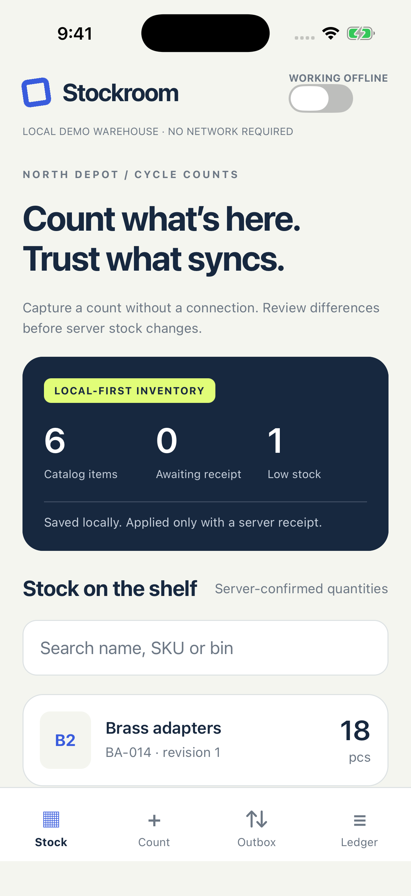
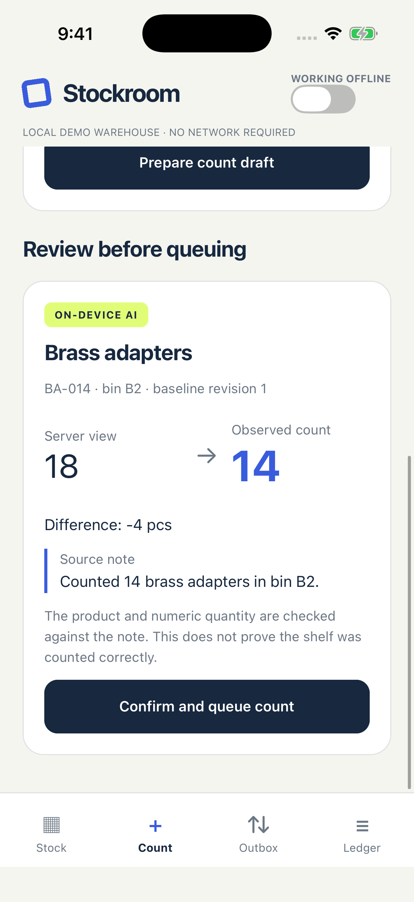
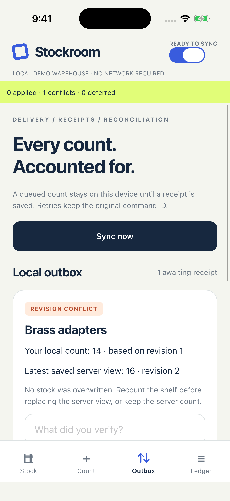
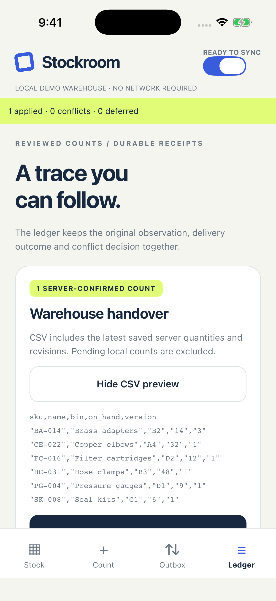
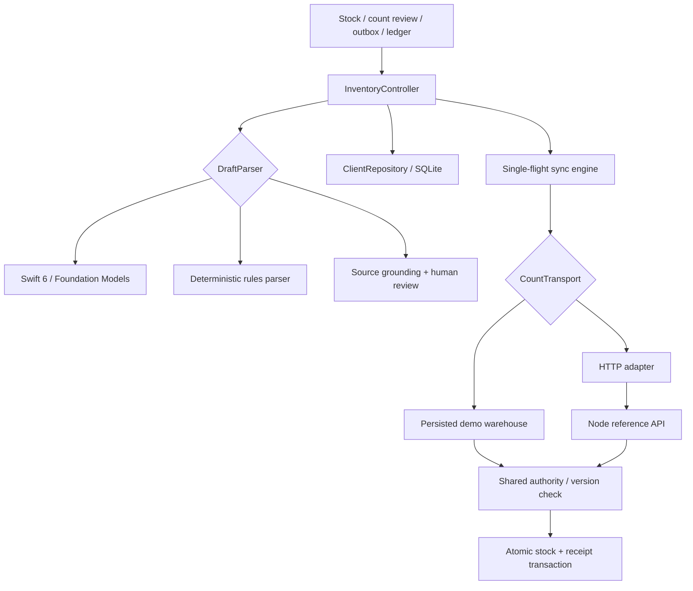

# Stockroom

Offline cycle counts with reviewed drafts, durable delivery and explicit conflict resolution.

[](https://github.com/OwaisMunawar/stockroom/actions/workflows/ci.yml)


[](LICENSE)

<p>
  
  
  
  
</p>

Unedited iPhone 17 Pro **simulator** captures on iOS 26.5. Warehouse data and count notes are synthetic. Foundation Models ran for real; the default warehouse authority is a deterministic local demo. [Verification scope and screenshot provenance](docs/VERIFICATION.md).

## Why

Two people counting the same shelf are making competing observations, not additive changes. Merging “I counted 14” and “I counted 16” into 30 is wrong; silently keeping the last arrival can be wrong too.

Stockroom queues an observed count against the server revision the inspector reviewed. A matching revision produces a durable receipt and a new quantity. A stale revision produces a conflict, with both values retained for a person to resolve. If the server commits but the acknowledgement is lost, retrying the same command ID returns the saved result rather than applying the count twice.

## Features

- **Local-first capture.** SQLite saves the reviewed count and its initial history event in one transaction. Queued observations stay separate from the server-confirmed inventory shown in the catalog.
- **Real local AI with a narrow job.** A Swift 6 Expo module asks Apple Foundation Models for a catalog index and integer quantity. TypeScript checks that the named product and exact numeral occur in the source note. The model never writes stock or invents catalog entries; the user reviews before queueing.
- **Explicit alternatives.** The rules parser uses the same draft interface and is labelled “No model.” Manual entry is also available. Estimated counts, decimals, number words and notes containing multiple numeric quantities are rejected by the note parser.
- **Durable outbox.** One active count per product, stable command IDs, deterministic exponential backoff, bounded retry attempts, and explicit resume after five delivery failures. A failed item does not block a different product.
- **Conflict review.** Compare the local observation with the latest saved server view. A reviewed recount creates a new command linked to the original; keeping the server count records the decision without another stock mutation.
- **Replay-safe authority.** SQLite commits the stock update and its receipt together. Reusing an ID with changed payload data fails. Conflicts are also receipted, so retries preserve the original outcome.
- **Inspectable history.** Append-only event triggers preserve normal application history. CSV exports include saved server quantities and versions, excluding pending local observations; quoted cells and formula prefixes are escaped.
- **Two delivery adapters.** The default persisted demo authority needs no server or key. A separate Node/SQLite HTTP reference server speaks the same validated protocol. Demo and HTTP client data use separate databases.

## Architecture



`shared/` contains platform-independent contracts, count rules and authority logic. `src/features/counts` separates application orchestration, data adapters and screens. SQL drivers, model adapters, transport, clock and ID generation are injected. ESLint blocks server/Node imports in mobile code and platform imports in the domain. [Architecture decisions and rejected alternatives](docs/ARCHITECTURE.md).

## Tech stack

| Concern             | Choice                                                                                     |
| ------------------- | ------------------------------------------------------------------------------------------ |
| Mobile              | React Native 0.86.3, Expo SDK 57.0.31, React 19.2.3                                        |
| Types and contracts | TypeScript strict + `noUncheckedIndexedAccess`, Zod 4.6.7                                  |
| Persistence         | expo-sqlite on mobile; Node's built-in SQLite in the reference server and tests            |
| Native drafts       | Apple Foundation Models, guided Swift generation, Swift 6 complete concurrency checking    |
| UI                  | Shared React Native primitives, safe areas, semantic controls and keyboard-aware scrolling |
| Quality             | Jest, React Native Testing Library 14, real SQLite/HTTP tests, XCTest simulator workflows  |

SDK 57 is a deliberate compatibility choice for the verified Xcode 26.6 toolchain. SDK upgrades are reviewed with their native toolchain changes. Android uses rules/manual entry; the Foundation Models adapter is iOS-only.

## Quick start

Requires Node 22.13 or newer, npm, and an iOS development environment for a native build. No account or API key is required.

```sh
git clone https://github.com/OwaisMunawar/stockroom.git && cd stockroom
npm ci
npm run ios
```

Open **Count**, review the default sample note, and confirm it into the outbox. Enable the app's connection switch and press **Sync now**. To exercise a conflict first, run the **competing demo count** while your observation is queued. The switch gates application delivery; it does not change OS network settings.

On supported iOS 26 environments, an available Foundation Models model is selected by default. Switch it off for the labelled rules parser. For a fully deterministic demo, build with `EXPO_PUBLIC_DEMO=1 npm run ios`; this forces the local warehouse and rules parser. `npm run android` builds the Android app with rules/manual entry.

### HTTP reference server

```sh
npm run server
EXPO_PUBLIC_SYNC_ORIGIN=http://127.0.0.1:8057 npm run ios
```

Run those commands in separate terminals. The simulator can reach the host loopback server. The app must be rebuilt after changing `EXPO_PUBLIC_*` values. `GET /v1/catalog` returns the warehouse view; `POST /v1/counts` returns an applied or conflict receipt. [Protocol and retry behavior](docs/PROTOCOL.md).

The server defaults to loopback and has **no authentication or tenant isolation**. It is a single-warehouse reference implementation. Add those controls before exposing it to other users. `server/Dockerfile` has a separate minimal runtime lockfile; bind any local container port explicitly to loopback.

## Quality

```sh
npm run format:check
npm run lint
npm run typecheck
npm run test:coverage
npm run doctor
bash tool/build-ios.sh
```

- **52 tests passed** across domain rules, real SQLite repositories, HTTP, sync orchestration and four screen interaction tests.
- The selected domain/application/repository/API scope measured **99.0% line coverage (308/311)** and **93.2% branch coverage**. CI gates lines/statements/functions at 90% and branches at 85%.
- Real database tests cover duplicate delivery, changed-payload IDs, concurrent counts, close/reopen persistence, trigger enforcement, invalid receipts, stale revisions and deliberate conflict decisions.
- A lost-acknowledgement test commits on the authority, drops the result, then retries with the same ID and proves only one stock version was written.
- The iOS simulator workflow exercised real native inference, local queueing, a competing count, conflict review, a replacement receipt and server-only CSV output. Native UI tests are run locally; CI does not require Foundation Models availability.
- A separate native workflow delivered a real on-device draft over HTTP; an independent catalog request confirmed 14 at revision 2. [Full verification record](docs/VERIFICATION.md).
- Expo Doctor passed 21/21 checks. A scoped validator override removes the high-severity transitive Zod advisory while retaining SDK compatibility. The last audit had no high/critical advisories; lower-severity tooling advisories remain documented in [SECURITY.md](SECURITY.md).
- CI checks formatting, lint boundaries, types, coverage, Expo compatibility, high-severity dependency advisories, the reference server image, an unsigned iOS release build, and an Android debug build.
- `.maestro/count.yaml` is provided but **unrun** because Maestro is not installed in the verification environment.

## Known gaps

- No physical-device, Android runtime, VoiceOver, low-memory, production or real-warehouse validation. Simulator and CI build results are not device results.
- One fixed sample catalog and warehouse. No catalog editor, authentication, roles, tenant isolation, barcode scanning or sales/fulfillment engine.
- Exact source grounding cannot prove an observation is true. Native generation may fail or time out; rules and manual entry remain available. Only explicit whole-number notes are supported.
- Sync is user-triggered in the foreground. There is no background-task or push-delivery guarantee. Counts read into memory have no pagination or retention policy.
- The reference server uses one SQLite connection per process; it is not designed for multiple writers in separate server processes. Production database coordination, backups and migrations require further work.
- Local databases have no extra application-layer encryption or biometric lock. Event triggers are local integrity checks, not a tamper-proof audit system.
- A queued command cannot be edited or silently discarded: it may already have committed remotely without a local acknowledgement. Reconcile the receipt, then record a corrective count.
- CSV is a stock snapshot, not a backup/restore format. Native share-sheet completion is not verified.

## Roadmap

- Warehouse identity, authentication and scoped operator roles.
- Catalog management, barcode-assisted counting and paginated history.
- Background delivery with explicit platform limits and connectivity recovery tests.
- Encrypted storage, retention and reviewed backup/restore procedures.
- Physical-device accessibility, Android runtime and adverse-network testing.

Built by [Owais Munawwar](https://github.com/OwaisMunawar). I'm available for React Native, AI and iOS work on [Upwork](https://www.upwork.com/freelancers/owaism11).
